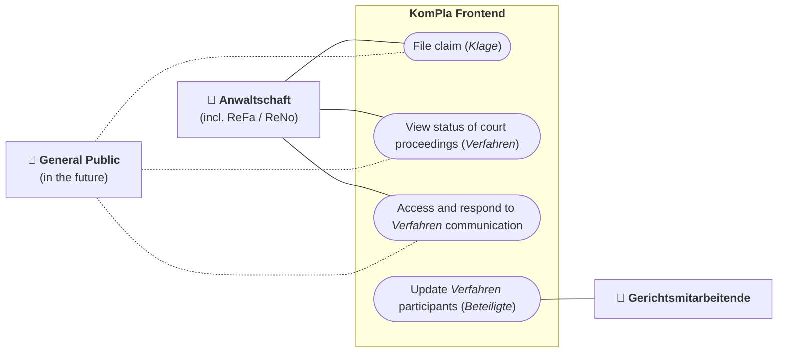
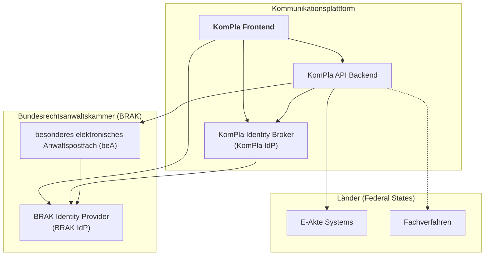

# Architecture

This document explains the context, principles and main elements of the _Kommunikationsplattform_ (_KomPla_) frontend architecture.

> [!note]
> The KomPla API backend is developed separately and is covered only briefly here to provide context. A link to the backend's architecture documentation will be provided here once available.

## Context

### User Groups

The main target users of the KomPla frontend are members of the _**Anwaltschaft**_ (lawyers) and those acting on their behalf, such as specially trained employees (known as _Rechtsanwaltsfachangestellte_ / _ReFa_ or _Rechtsanwalts- und Notarfachangestellte_ / _ReNo_). The web app allows them to:

- File claims (_Klagen_) with accompanying pieces of evidence (_Beweismittel_)
- View the status of court proceedings (_Verfahren_)
- Access communication by the court and the opposing party and respond to it

Employees of the courts (**Gerichtsmitarbeitende**) usually interact with the KomPla only indirectly, through integrations of the API backend with their _E-Akte_ and, eventually, _Fachverfahren_ systems (see [Technical Landscape](#technical-landscape)). The one exception is updating the list of participants (_Beteiligte_) in a _Verfahren_, which for the time being _Gerichtsmitarbeitende_ will have to do both in their _Fachverfahren_ and the KomPla frontend due to the missing synchronization between the two.

In the future, the KomPla may be opened up to general citizens so that plaintiffs (_Klagende_) and defendants (_Beklagte_) can access the communication concerning their _Verfahren_ directly. For now, though, there is no ability for them to log into the KomPla.

### Technical Landscape

#### KomPla API Backend

The API backend is the main component that the frontend communicates it. It implements most of the KomPla's domain logic and integrations with external systems, exposing this funcitionlality as a REST API. For instance, it offers API endpoints to create _Verfahren_, send bundles of uploaded files (_Einreichungen_) to the courts and opposing parties, and retrieve Verfahren details.

The API relies on access tokens from the KomPla Identity Provider for authentiction (see below).

#### besonderes Anwaltspostfach (beA)

The _besondere Anwaltspostfach_ (beA) is a system provided by the German Federal Bar (_Bundesanwaltskammer_, or BRAK) that lets lawyers participate in secure legal document exchange (_Elektronischer Rechtsverkehr_) with other parties in the German justice system, most notably courts. Every lawyer has a personal beA inbox (_Postfach_) identified by a [_SAFE-ID_][safe-id], which doubles as a unique user identifier.

The KomPla frontend does not directly interact with beA. However, the API backend uses it to send notifications to KomPla users, who can then follow an embedded deep link into the frontend.

[safe-id]: https://egvp.justiz.de/

#### BRAK Identity Provider (BRAK IdP)

The BRAK IdP is the beA's identity management solution based on the [OpenID Connect][openid-connect] protocol. It implements the login flow for the beA web portal and mobile app; in addition, it lets users log into registered third-party applications with their beA credentials (a cryptographic hardware token or software certificate).

The KomPla frontend is registered as a BRAK IdP client so that it can offer beA login to users from the Anwaltschaft (including ReFas / ReNos). For access to the KomPla API, it exchanges access tokens from the BRAK IdP for tokens from the KomPla Identity Broker (described below).

[openid-connect]: https://openid.net/developers/how-connect-works/

#### KomPla Identity Broker (KomPla IdP)

To support multiple Identity Providers in the future (such as [Bund ID][bund-id] when the KomPla is eventually opened to the general public) while providing a single form of user accounts and access tokens to API consumer, the API backend is accompanied by the **KomPla Identity Broker** (also called **KomPla IdP**). This is a [Keycloak][keycloak] instance which hands out KomPla API access tokens in exchange for tokens from supported third-party identity providers. The token exchange is done through the [OAuth 2.0 JWT Authorization Grant flow][jwt-grant].

The frontend uses the KomPla IdP's token exchange features to exchange BRAK IdP access tokens for KomPla IdP ones. In non-production environments, it also offers the option of logging into the KomPla IdP with a username and password (again using OpenID Connect), which is handy for development and demos as it removes the need for a beA client certificate for logging in.

[bund-id]: https://id.bund.de/
[keycloak]: https://www.keycloak.org/
[jwt-grant]: https://www.keycloak.org/securing-apps/jwt-authorization-grant

#### Länder Systems (E-Akte, Fachverfahren)

Among the types of software systems used by the courts' employees (_Gerichtsmitarbeitende_), the following two are particularly relevant to the KomPla:

- _**E-Akte**_ (electronic file) systems, which are used to store and manage documents related to _Verfahren_, including those submitted by _Beteiligte_ and created by the court.

- **Fachverfahren**, which implement digitalized versions of the courts' internal worfklows.

The concrete systems depend on the federal state (_Land_), although consoldation efforts are under way, such as the [_Gemeinsame Fachverfahren_ (GeFa)][gefa] project for introducing a nation-wide _Fachverfahren_ solution.

The KomPla API backend integrates into the _E-Akte_ systems by storing submitted documents there and offering retrieval from them. The frontend accesses this functionality through API endpoints.

Integration of the API backend into _Fachverfahren_ will not be available at the start of the KomPla's pilot, but may be added later.

[gefa]: https://gefa-justiz.de/

## Architecture Principles

- **No client-side secrets:** Do not expose API access credentials or other secrets directly to client devices. This implies that operations that need such secrets (e.g., KomPla API requests or OAuth authorization requests) must be performed in a server-side component, not directly by the client.

- **Single codebase and deployment unit:** Despite the need for server code established above, we want to avoid the complexity of separate and independently deployed server and client codebases. Instead, it should be possible to implement both the server and client using a single programming language and app framework — with the ability to share code between both — and to deploy both as a single unit.

- **No server-side data storage:** The KomPla frontend deals with sensitive legal data. In order to minimize its attack surface, its server-side component should avoid any form of persistent storage, including for caching purposes. Instead, user data should be exclusively stored in the KomPla API backend's database or the external systems it integrates with (such as the _E-Akte_).

## Major Architectural Decisions

This section summarizes the main features of the KomPla frontend architecture and the reasoning behind them. For more details, see our [Architecture Decision Records](./adr/README.md).

### Programming Language & Framework

The KomPla frontend is written in [TypeScript][typescript] due to JavaScript ecosystem's excellent support for full-stack web applications and the extra correctness guarantees provided by TypeScript's static type system.

We use [**React**][react] for rendering and interactivity. [**React Router**][react-router] in [Framework Mode][react-router-framework] provides routing as well as both server-side and client-side rendering, data fetching, and action handlers, allowing us to write both the server and client as a single codebase and to hide secrets from clients (see [Architecture Principles](#architecture-principles)).

[react]: https://react.dev/
[react-router]: https://reactrouter.com/
[react-router-framework]: https://reactrouter.com/start/modes#framework
[typescript]: https://www.typescriptlang.org/docs/

### Styling

The KomPla frontend is built on top of the [KERN][kern-ux-plain] design system and component library. We use the [Plain-CSS-HTML-Kit][kern-ux-plain] reference implementation, wrapping its patterns in React components as needed, to avoid the extra indirections and potential issues introduced by a downstream wrapper like the [React-Kit][kern-ux-react] (not developed by the KERN core team).

We complement KERN with [Tailwind][tailwind]'s utility CSS classes, many of which have no equivalents in the KERN Plain-CSS-HTML-Kit.

[kern-ux]: https://www.kern-ux.de/
[kern-ux-plain]: https://gitlab.opencode.de/kern-ux/kern-ux-plain
[kern-ux-react]: https://gitlab.opencode.de/kern-ux/kern-react-kit
[tailwind]: https://tailwindcss.com/

### Authentication

Integrations into the BRAK IdP and KomPla IdP are implemented using [Better Auth][better-auth], a comprehensive authentication framework with excellent support for the OAuth 2.0 and OpenID Connect protocols, as well as for [stateless session management] using signed and encrypted session cookies (removing the need for server-side persistent storage as per our [architecture principles](#architecture-principles)). See [ADR 8](./adr/0008-switch-to-better-auth-after-all.md).

[better-auth]: https://better-auth.com/
[better-auth-stateless]: https://better-auth.com/docs/concepts/session-management#stateless-session-management

### Runtime & Distribution

[**Node.js**][node] is used as server-side JavaScript runtime for the app as it is the most mature and well-supported option. For distribution, the app is packaged as an [OCI][oci] container image for easy deployment and portability.

[node]: https://nodejs.org/
[oci]: https://opencontainers.org/

## Futher Resources

- [Architecture Decision Records](./adr/README.md)
- [Development](./DEVELOPMENT.md)
