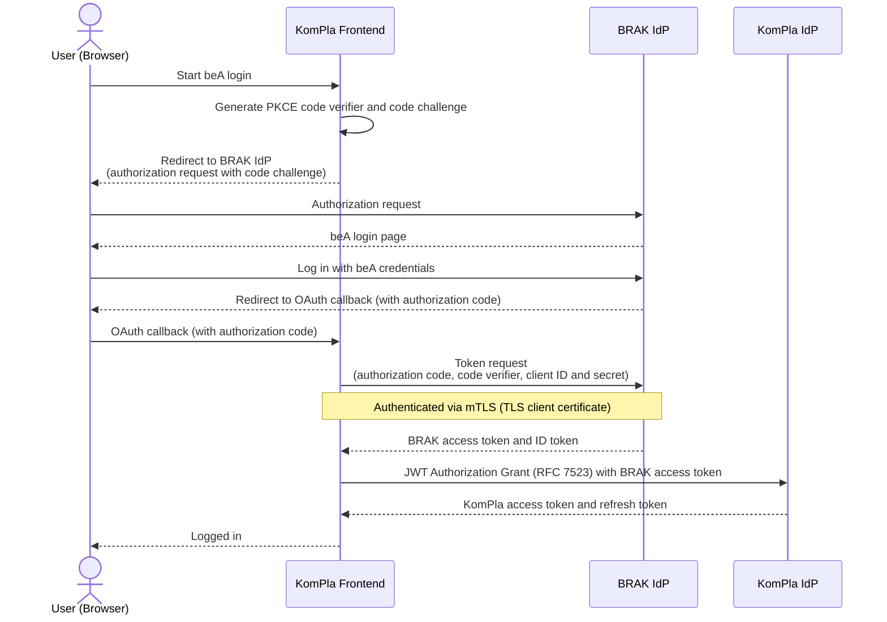
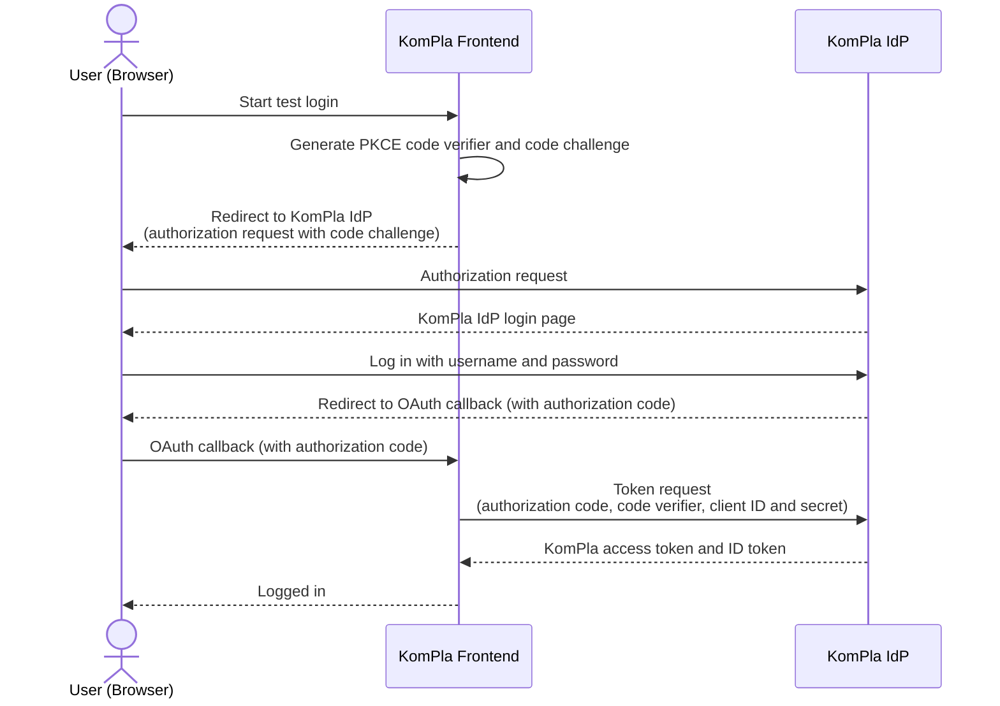

# Authentication

This document describes the KomPla frontend's authentication concept. Specifically, it details how the frontend integrates with the supported Identity Providers (IdP) and how access tokens from external Identity Providers are translated into KomPla API credentials.

## Identity Providers (IdP)

The KomPla frontend integrates with the following Identity Providers (see the [architecture overview](../architecture.md) for context):

- **KomPla Identity Broker (KomPla IdP):** The Identity Provider accompanying the KomPla API backend. The API expects all requests to be authenticated with KomPla IdP tokens using [HTTP Bearer Authentication][http-bearer].

- **BRAK Identity Provider (BRAK IdP):** The IdP behind the _besondere Anwaltspostfach_ (_beA_) login for lawyers (and their employees / representatives).

Both providers implement the [OAuth 2.0][oauth] and [OpenID Connect (OIDC)][openid-connect] protocols, which the frontend uses for integration.

[http-bearer]: https://www.rfc-editor.org/info/rfc6750/
[oauth]: https://oauth.net/2/
[openid-connect]: https://openid.net/developers/how-connect-works/

## Authentication Flows

This section provides technical details on the login options offered by the KomPla frontend.

### beA Login (BRAK IdP & KomPla IdP Token Exchange)

To let a user log in with their beA credentials (a hardware token or software certificate), the frontend starts an OAuth 2.0 / OpenID Connect [Authorization Code Flow][oauth-auth-code] with the BRAK IdP, redirecting to the beA login page. Once the user has logged in, the BRAK IdP redirects back to the frontend's OAuth callback URL, providing it with an authorization code that the frontend sends to the BRAK IdP's token endpoint to retrieve an [access token][access-token] and [ID token][id-token]. See ["How OpenID Connect Works" on openid.net][openid-connect-how-it-works].

For added security, [Proof Key for Code Exchange (PKCE)][pkce] is used in the authorization flow (in fact, the BRAK IdP requires it).

[access-token]: https://www.oauth.com/oauth2-servers/access-tokens/
[oauth-auth-code]: https://www.oauth.com/oauth2-servers/access-tokens/authorization-code-request/
[id-token]: https://www.oauth.com/oauth2-servers/openid-connect/id-tokens/
[openid-connect-how-it-works]: https://openid.net/developers/how-connect-works/
[pkce]: https://oauth.net/2/pkce/

#### mTLS Client Authentication

In addition to OAuth client credentials (client ID and secret), the BRAK IdP's token endpoint requires clients to present a trusted TLS client certificate for authentication, a.k.a. [mutual TLS (mTLS)][mtls]. The certificate is expected to match the following criteria:

- **Extended Key Usage:** TLS Web Client Authentication (OID 1.3.6.1.5.5.7.3.2)
- **Public Key Algorithm:** RSA (3072 / 4096 bits) or ECDSA (P-256 / P-384)
- **Validity:** At least 12 months

The certificate must be acquired externally and submitted (without the private key) to the BRAK, which will associate it with the application's OAuth client ID. As of October 2026, we use a [_beA-Softwarezertifikat_ from the Bundesnotarkammer (BNotK)][bnotk-bea] for our staging environment and will acquire a separate certificate for production.

[mtls]: https://en.wikipedia.org/wiki/Mutual_authentication#mTLS
[bnotk-bea]: https://zertifizierungsstelle.bnotk.de/bestellen/beaprodukte

#### Token Exchange (RFC 7523)

After the tokens have been retrieved from the BRAK IdP, the frontend sends an [OAuth JWT Authorization Grant (RFC 7523)][jwt-grant] request to the KomPla IdP, providing the BRAK access token as proof of identity (`assertion`).

On success, the KomPla IdP responds with an access token for the KomPla IdP user linked to the beA account, allowing the frontend to access the KomPla API on behalf of that user. The response also includes a [refresh token][refresh-token], which the frontend uses to fetch a new access token when the current one expires.

[jwt-grant]: https://www.rfc-editor.org/info/rfc7523/
[refresh-token]: https://www.oauth.com/oauth2-servers/making-authenticated-requests/refreshing-an-access-token/

### Test Login (KomPla IdP Only)

To simplify testing in non-production environments, the KomPla IdP offers the option to log in directly with a username and password, without involving any external identity provider. This makes it possible for developers and other team members — as well as for automated end-to-end tests — to log into the frontend without having to handle beA software certificates, for instance.

The frontend integrates this login option using the normal OAuth Authorization Code Flow (with PKCE); as that results immediately in KomPla IdP tokens, no token exchange is needed.

## Session Management

After login, the frontend needs access to the user's access and refresh tokens so that it can make KomPla API requests, as well as to user details to adjust the user interface, e.g., to display the user's name in the header.

However, to avoid server-side storage (see the [architecture overview](../architecture.md)), such user session data is not stored in a database. Instead, the frontend's server uses [Better Auth's "stateless session management" feature][better-auth-stateless] to send a set of encrypted cookies to the browser, which then saves these to its cookie store. When the server receives a request, it decrypts the cookies included by the browser and extracts the contained session data for use by the request handler.

[better-auth-stateless]: https://better-auth.com/docs/concepts/session-management#stateless-session-management

## Further Reading

- [ADR 8: Switch to Better Auth (after all)](../adr/0008-switch-to-better-auth-after-all.md)
