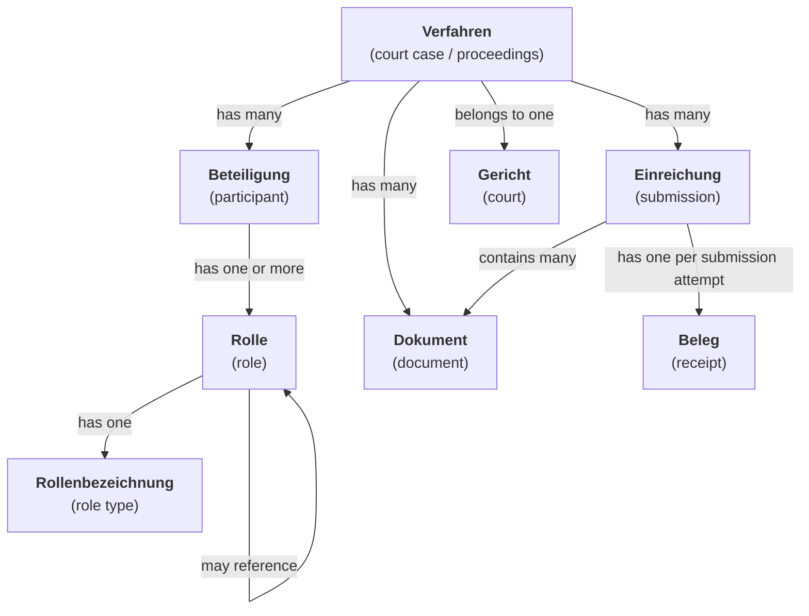
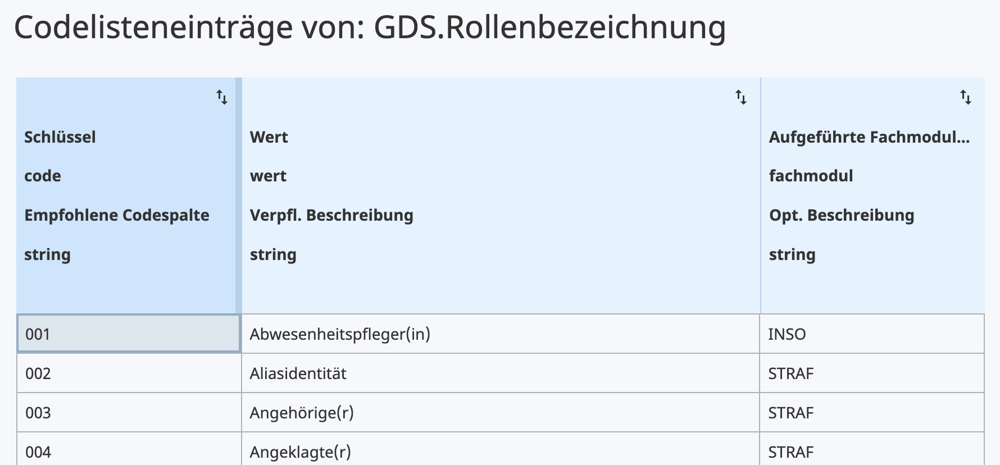

# Domain Model

This document gives an overview of the domain concepts behind the _Kommunikationsplattform_ (KomPla) API and frontend data model.

> [!note]
> The domain model is designed to align closely with [**XJustiz**][xjustiz], a standardized information model and XML-based exchange format for structured data related to court cases (_Verfahrensdaten_). Due to the KomPla's narrower scope, its domain model only reflects a small subset of what XJustiz specifies — specifically, parts of the GDS (_Grunddatensatz_) and KLAVER (_Klageverfahren_) modules — and there are some simplifications to make the KomPla API easier to use.

[xjustiz]: https://xjustiz.justiz.de/

## Overview

### _Verfahren_ & _Gerichte_

The KomPla revolves around _**Verfahren**_ (court case / proceedings). A _Verfahren_ holds the general details of the case, such as:

- _Verfahrensgegenstand_: A one-line summary of the claim
- _Kurzrubrum_: A "subject line" for the _Verfahren_, usually of the form "`A` ./. `B`" where `A` and `B` are the (last) names of the main plaintiffs and defendants, respectively

Every (non-draft) _Verfahren_ is associated with the _**Gericht**_ (court) handling it, represented by a unique code from the [`Registergerichte` code list][xunternehmen-registergerichte] maintained as part of the [XUnternehmen][xunternehmen] standard (see the [section on code lists](#code-lists-codelisten) below). The _Gericht_ assigns an _Aktenzeichen_ (case number) to each _Verfahren_ it accepts.

> [!note]
> For the time being, the _Kommunikationsplattform_ supports only _Zivilverfahren_ (civil court cases) and, more specifically, _Zahlungsklagen_ (payment claims). Also, the initial pilot is limited to particular _Amtsgerichte_, so higher-instance civil courts (i.e., _Landgerichte_) are not included.

[xunternehmen]: https://xunternehmen.de/
[xunternehmen-registergerichte]: https://www.xrepository.de/details/urn:xoev-de:xunternehmen:codeliste:registergerichte

### _Beteiligungen_ & _Rollen_

_**Beteiligungen**_ (participations) represent the _Beteiligte_ (participants) involved in the _Verfahren_, as well as their _**Rollen**_ (roles). The types of roles (_Rollenbezeichnungen_) include _klagende / beklagte Parteien_ (plaintiffs / defendants), _gesetzliche Vertretungen_ (legal guardians, e.g., parents of minors) and _Prozessbevollmächtigte_ (legal representatives, i.e., lawyers).

> [!important]
> A _Rolle_ represents a **person in a particular role**, not the type of role itself (that would be _Rollenbezeichnung_).

> [!note]
> While the KomPla API defines a long list of _Rollenbezeichnungen_ adopted from the XJustiz [`GDS.Rollenbezeichnung` code list][xjustiz-rollenbezeichnung], the frontend only exposes those denoting the opposing parties (_Klagende_ / _Beklagte_) and their representatives.

[xjustiz-rollenbezeichnung]: https://www.xrepository.de/details/urn:xoev-de:xjustiz:codeliste:gds.rollenbezeichnung

_Rollen_ are identified by _Rollennummern_ (role numbers) and can contain **references** (_**Referenzen**_) to each other. For instance, a lawyer's _Rolle_ of type _"Prozessbevollmächtigte(r)"_ is expected to have a reference to the _Rolle(n)_ of the _Beteiligte_ represented by the lawyer.

### _Dokumente_

Communication within a _Verfahren_ happens through _**Dokumente**_ (documents). Each _Dokument_ is file with associated metadata. Among this metadata is the _**Dokumenttyp**_ (document type), which is one of the following:

- `SCHRIFTSTUECK`: Denotes the _Klageschrift_ (claim document), which is a formal document containing all details of the claim, as required by law. The document is expected to be in PDF format, although for the time being, Word (`.docx`) files are silently accepted as well to accommodate common practice.

- `ANHANG`: A generic attachment, such as a piece of evidence (_Beweismittel_) or a request for assistance with court costs (_Antrag auf Prozesskostenhilfe_).

- `SIGNATURDATEI`: A signature file (`.p7s` / `.pkce7`) for verifying a digital signature on the _Klageschrift_ or the _Anhänge_.

- `XJUSTIZ`: An XJustiz XML file with a structured _Verfahren_ data. For instance, a _Klageeinreichung_ (see next section) is expected to include an XJustiz file with the basic details of the requested _Verfahren_, generated by the API backend.

In addition, a _Dokument_ has a display name (_Anzeigename_), usually the filename. There is also a "visible to all" flag (_Sichtbarkeit Alle_) that controls whether a _Dokument_ can be seen by all _Beteiligte_ of the _Verfahren_ of just by the court and submitting party.

### _Einreichungen_ & _Belege_

The opposing parties of a _Verfahren_ submit _Dokumente_ in as bundles called _**Einreichungen**_ (submissions). In addition to the _Dokumente_ themselves, an _Einreichung_ has a name that provides context for the submission, e.g. _"Klageeinreichung"_ for the initial _Einreichung_ containing the _Klageschrift_ and the accompanying _Beweismittel_.

> [!important]
> Courts do NOT submit _Einreichungen_. Their _Dokumente_ are standalone, meaning that they are not associated with any _Einreichung_ or grouped in any other way.

After an _Einreichung_ has been submitted (_eingereicht_), a _**Beleg**_ (receipt) is generated which communicates the result of the submission attempt. There are two types of _Beleg_:

- `NACHWEIS`: A document serving as proof (_Nachweis_) of successful submission.
- `PROTOKOLL`: A document indicating that the submission failed, with diagnostic logs (_Protokoll_) for debugging the problem.

## Details

This section dives into particular aspects of the domain model. It lays no claim to being comprehensive, but should help with navigating some of the trickier and not-so-obvious features of the model.

### Code Lists (_Codelisten_)

Several entities of the KomPla domain model are enumeration-like, such as _Gerichte_ and _Rollenbezeichnungen_ (see the [domain model overview](#overview)). For extensibility, it is often desirable for the possible values and their human-readable names to be dynamically queryable rather than hardcoded in the backend or, worse, the frontend.

To address this desire, XJustiz — or, more precisely, the [XÖV][xoev] family of XML standards for German e-government services — defines the concept of **code lists** (_**Codelisten**_), based on the [OASIS Genericode][genericode] XML standard. Every code list is basically a table with named columns and a primary ("recommended") key — usually, but not always, a single column called `code`. (Secondary and compound keys may also be defined.)

<figure>
  
  <figcaption>An excerpt of the <a href="https://www.xrepository.de/details/urn:xoev-de:xjustiz:codeliste:gds.rollenbezeichnung">GDS.Rollenbezeichnung</a> code list as rendered in XRepository</figcaption>
</figure>

The KomPla reuses XÖV code lists for its domain model, and the backend API offers endpoints to receive the supported types of code lists (e.g., `GET /api/v1/codelisten/gerichte`). Instead of fully exposing the structure of the source code lists, though, it offers a simple unified model with just two fields per code list entry:

- `code`: The entry's unique identifier (key)
- `wert`: A human-readable, German-language name

> [!important]
> The KomPla API also returns an `id` for each entry. These IDs are internal to the KomPla backend and not part of the upstream XÖV code lists. Both `id` and `code` are guaranteed to be unique across entries of the same code list.

[xoev]: https://www.itzbund.de/DE/itloesungen/standardloesungen/xoev/xoev.html
[genericode]: https://docs.oasis-open.org/codelist/cs-genericode-1.0/doc/oasis-code-list-representation-genericode.html

### _Verfahren_ Lifecycle

TODO

### _Einreichung_ Lifecycle

TODO

### _Dokument_ & _Einreichung_ Validation
