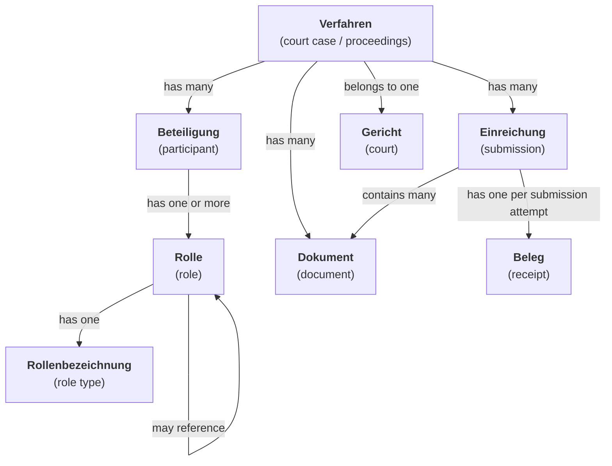
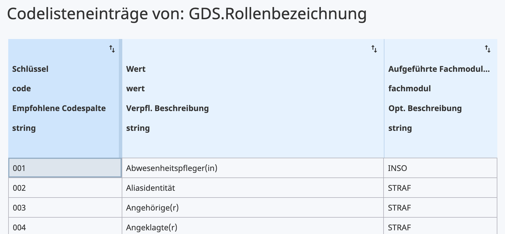
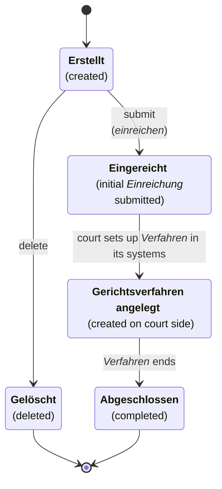
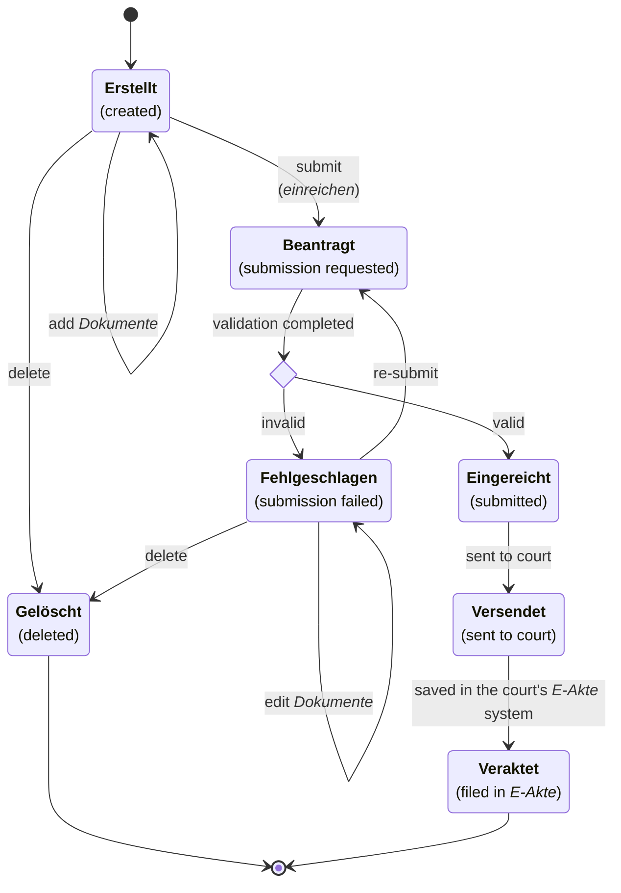
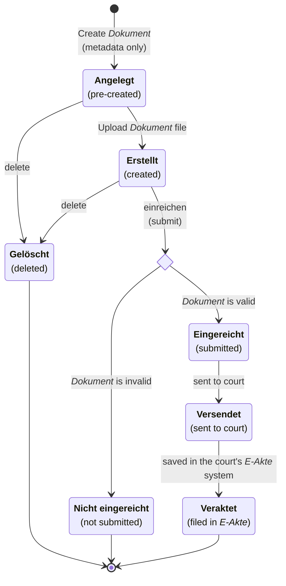

# Domain Model

This document gives an overview of the domain concepts behind the _Kommunikationsplattform_ (KomPla) API and frontend data model.

> [!note]
> The domain model is designed to align closely with [**XJustiz**][xjustiz], a standardized information model and XML-based exchange format for structured data related to court cases (_Verfahrensdaten_). Due to the KomPla's narrower scope, its domain model only reflects a small subset of what XJustiz specifies — specifically, parts of the GDS (_Grunddatensatz_) and KLAVER (_Klageverfahren_) modules — and there are some simplifications to make the KomPla API easier to use.

[xjustiz]: https://xjustiz.justiz.de/

## Overview

### _Verfahren_ & _Gerichte_

The KomPla revolves around _**Verfahren**_ (court case / proceedings). A _Verfahren_ holds the general details of the case, such as:

- _Verfahrensgegenstand_: A one-line summary of the claim
- _Kurzrubrum_: A "subject line" for the _Verfahren_, usually of the form "`A` ./. `B`" where `A` and `B` are the (last) names of the main plaintiffs and defendants, respectively

Every (non-draft) _Verfahren_ is associated with the _**Gericht**_ (court) handling it, represented by a unique code from the [`Registergerichte` code list][xunternehmen-registergerichte] maintained as part of the [XUnternehmen][xunternehmen] standard (see the [section on code lists](#code-lists-codelisten) below). The _Gericht_ assigns an _Aktenzeichen_ (case number) to each _Verfahren_ it accepts.

> [!note]
> For the time being, the _Kommunikationsplattform_ supports only _Zivilverfahren_ (civil court cases) and, more specifically, _Zahlungsklagen_ (payment claims). Also, the initial pilot is limited to particular _Amtsgerichte_.

[xunternehmen]: https://xunternehmen.de/
[xunternehmen-registergerichte]: https://www.xrepository.de/details/urn:xoev-de:xunternehmen:codeliste:registergerichte

### _Beteiligungen_ & _Rollen_

_**Beteiligungen**_ (participations) represent the _Beteiligte_ (participants) involved in the _Verfahren_, as well as their _**Rollen**_ (roles).

There are three kinds of _Beteiligte_ (_Beteiligtenarten_):

- **Natürliche Person:** An individual, a.k.a. natural person
- **Organisation:** A company or other type of organization
- **Rechtsanwaltskanzlei:** A law firm

The types of roles (_Rollenbezeichnungen_) include _klagende / beklagte Parteien_ (plaintiffs / defendants), _gesetzliche Vertretungen_ (legal guardians, e.g., parents of minors) and _Prozessbevollmächtigte_ (legal representatives, i.e., lawyers).

> [!important]
> A _Rolle_ represents a **certain _Beteiligte_ in a particular type of role**, not the type of role itself (that would be _Rollenbezeichnung_).

> [!note]
> While the KomPla API defines a long list of _Rollenbezeichnungen_ adopted from the XJustiz [`GDS.Rollenbezeichnung` code list][xjustiz-rollenbezeichnung], the frontend only exposes those denoting the opposing parties (_Klagende_ / _Beklagte_) and their representatives.

[xjustiz-rollenbezeichnung]: https://www.xrepository.de/details/urn:xoev-de:xjustiz:codeliste:gds.rollenbezeichnung

_Rollen_ are identified by _Rollennummern_ (role numbers) and can contain **references** (_**Referenzen**_) to each other. For instance, a lawyer's _Rolle_ of type _"Prozessbevollmächtigte(r)"_ is expected to have a reference to the _Rolle(n)_ of the _Beteiligte_ represented by the lawyer.

### _Dokumente_

Communication within a _Verfahren_ happens through _**Dokumente**_ (documents). Each _Dokument_ is a file with associated metadata. Among this metadata is the _**Dokumenttyp**_ (document type), which is one of the following:

- `SCHRIFTSTUECK`: The main written document in an _Einreichung_ (see [next section](#einreichungen--belege)), such as the _Klageschrift_ (claim document) in a _Klageeinreichung_ (claim submission). The document is expected to be a PDF file, although for the time being, Word (`.docx`) files are also silently accepted to accommodate common practice.

- `ANHANG`: A generic attachment, such as a piece of evidence (_Beweismittel_) or a request for assistance with court costs (_Antrag auf Prozesskostenhilfe_).

- `SIGNATURDATEI`: A signature file (`.p7s` / `.p7m` / `.pkcs7`) for verifying a digital signature on the _Klageschrift_ or the _Anhänge_.

- `XJUSTIZ`: An XJustiz XML file with structured _Verfahren_ data. For instance, a _Klageeinreichung_ (see next section) is expected to include an XJustiz file with the basic details of the requested _Verfahren_, generated by the API backend.

In addition, a _Dokument_ has a display name (_Anzeigename_), usually the filename. There is also a "visible to all" flag (_Sichtbarkeit Alle_) that controls whether a _Dokument_ can be seen by all _Beteiligte_ of the _Verfahren_ or just by the court and submitting party.

### _Einreichungen_ & _Belege_

The _Beteiligte_ of a _Verfahren_ submit _Dokumente_ in bundles called _**Einreichungen**_ (submissions). In addition to the _Dokumente_ themselves, an _Einreichung_ has a name that provides context for the submission, e.g., _"Klageeinreichung"_ for a claim submission.

> [!important]
> Courts do NOT submit _Einreichungen_. Their _Dokumente_ are standalone, meaning that they are not associated with any _Einreichung_ or grouped in any other way.

After an _Einreichung_ has been submitted (_eingereicht_), a _**Beleg**_ (receipt) is generated, which communicates the result of the submission attempt. There are two types of _Beleg_:

- `NACHWEIS`: A document serving as proof (_Nachweis_) of successful submission.
- `PROTOKOLL`: A document indicating that the submission failed, with diagnostic logs (_Protokoll_) for debugging the problem.

## Details

This section dives into particular aspects of the domain model. It lays no claim to being comprehensive, but should help with navigating some of the trickier and not-so-obvious features of the model.

### Code Lists (_Codelisten_)

Several entities of the KomPla domain model are enumeration-like, such as _Gerichte_ and _Rollenbezeichnungen_ (see the [domain model overview](#overview)). For extensibility, it is often desirable for the possible values and their human-readable names to be dynamically queryable rather than hardcoded in the backend or, worse, the frontend.

To address this, XJustiz — or, more precisely, the [XÖV][xoev] family of XML standards for German e-government services — defines the concept of **code lists** (_**Codelisten**_), based on the [OASIS Genericode][genericode] XML standard. Every code list is a table with named columns and a primary ("recommended") key — usually, but not always, a single column called `code`. (Secondary and compound keys may also be defined.)

<figure>
  
  <figcaption>An excerpt of the <a href="https://www.xrepository.de/details/urn:xoev-de:xjustiz:codeliste:gds.rollenbezeichnung">GDS.Rollenbezeichnung</a> code list as rendered in XRepository</figcaption>
</figure>

The KomPla reuses XÖV code lists for its domain model, and the backend API offers endpoints to receive the supported types of code lists (e.g., `GET /api/v1/codelisten/gerichte`). Instead of fully exposing the structure of the source code lists, though, it offers a simple unified model with just two fields per code list entry:

- `code`: The entry's unique identifier (key)
- `wert`: A human-readable, German-language name

> [!important]
> The KomPla API also returns an `id` for each entry. These IDs are internal to the KomPla backend and not part of the upstream XÖV code lists. Both `id` and `code` are guaranteed to be unique across entries of the same code list.

[xoev]: https://www.itzbund.de/DE/itloesungen/standardloesungen/xoev/xoev.html
[genericode]: https://docs.oasis-open.org/codelist/cs-genericode-1.0/doc/oasis-code-list-representation-genericode.html

### Entity Status & Lifecycle

Several domain entities have defined states (_Status_) and transitions between them. These are described below.

#### _Verfahren_ Lifecycle

A new _Verfahren_ starts as a draft, represented by the `ERSTELLT` (created) state. The user can edit the _Verfahren_ details, including its _Beteiligungen_, and construct the initial _Einreichung_, usually containing the legal claim document (_Klageschrift_), pieces of evidence (_Beweismittel_) and possibly other attachments like an _Antrag auf Prozesskostenhilfe_ (application for assistance with court and legal costs).

While it is a draft, it is also possible to delete the _Verfahren_, transitioning it to the `GELOESCHT` (deleted) state.

Once the initial _Einreichung_ has been submitted successfully, the _Verfahren_ moves to the `EINGEREICHT` (submitted) state. From this point on, the _Verfahren_ can no longer be deleted or freely edited.

After the _Verfahren_ has been created in the court's internal systems and the assigned _Aktenzeichen_ (case number) has been reported back to the KomPla backend, the _Verfahren_'s state changes to `GERICHTSVERFAHRENANGELEGT`.

Finally, after the _Verfahren_ has ended, it is moved to the `ABGESCHLOSSEN` (completed) state. It remains there for 30 days before being automatically deleted from the KomPla for data privacy reasons.

> [!note]
> As the KomPla backend is currently not integrated with the courts' _Fachverfahren_ software, court employees need to manually mark a _Verfahren_ as `ABGESCHLOSSEN` in the KomPla frontend.

#### _Einreichung_ Lifecycle

Like _Verfahren_, an _Einreichung_ starts as a draft (`ERSTELLT` state) to which one or more _Dokumente_ can be added. The draft can also be deleted, moving it to the `GELOESCHT` (deleted) state.

Once the _Einreichung_ is submitted (_einreichen_), it moves to the `BEANTRAGT` (submission requested) state until its validation has been completed (see [below](#dokument--einreichung-validation)). The next state depends on the validation result:

- If validation fails, the _Einreichung_ moves into the `FEHLGESCHLAGEN` (failed) state. Like `ERSTELLT`, this is considered a draft state, allowing the user to edit the _Einreichung_ contents and try again (or delete the _Einreichung_).

- Otherwise, the _Einreichung_ is considered `EINGEREICHT` (submitted) until the _Dokumente_ of the _Einreichung_ have been successfully sent to the court, at which point the state changes to `VERSENDET` (sent). Once the court has filed the _Dokumente_ in its _E-Akte_ system, the _Einreichung_ reaches the final `VERAKTET` (filed) state.

On submission of the _Einreichung_, a placeholder for the matching _Beleg_ (see [above](#einreichungen--belege)) is created, marked as such by the `IN_BEARBEITUNG` (in progress) state. Once the _Einreichung_ enters the `EINGEREICHT` or `FEHLGESCHLAGEN` state, the _Beleg_ is marked `ERSTELLT` and given the type `NACHWEIS` or `PROTOKOLL`, respectively.

#### _Dokument_ Lifecycle

The _Dokument_ states are document-scoped versions of the equivalent _Einreichung_ ones. There are some differences, though:

- The initial draft state is not `ERSTELLT`, but `ANGELEGT` (roughly "pre-created"). In this state, the _Dokument_ metadata has been defined, but the actual file has not been uploaded yet; in the KomPla API, these are separate operations.

- The validation failure state is called `NICHT_EINGEREICHT` instead of `FEHLGESCHLAGEN`.

### _Dokument_ & _Einreichung_ Validation

Whenever a _Dokument_ or _Einreichung_ is created or edited, it is asynchronously checked against a set of validation rules. Examples are:

- A _Dokument_ must pass a scan for viruses and other malware
- An _Einreichung_ must include exactly one _Dokument_ of type `SCHRIFTSTUECK`

Each rule check yields one of the following results:

- `GRUEN` (green): Validation rule passes
- `GELB` (yellow): Minor rule violation (warning)
- `ROT` (red): Severe rule violation (error)

The `GELB` and `ROT` results are accompanied by a (German) warning or error message.

The individual rule check results are combined into a single validation status (_Validierungsstatus_) for each _Dokument_ and _Einreichung_. It includes an aggregate validation result, determined as follows:

- `NICHT_VERFUEGBAR` while any of the checks is still pending
- `ROT` if at least one check yielded `ROT`
- `GELB` if no check yielded `ROT`, but at least one yielded `GELB`
- `GRUEN` if all checks yielded `GRUEN`

The validation status also includes all messages generated by the individual rule checks.

> [!note]
> The validation status of an _Einreichung_ reflects the validation results of its _Dokumente_ in addition to the checks on the _Einreichung_ itself. For instance, if the validation result of any _Dokument_ is `ROT`, the _Einreichung_'s result is `ROT` as well.

An _Einreichung_ can only be submitted if its validation result is either `GRUEN` or `GELB`. If it is `ROT`, the _Einreichung_ is considered invalid and any submission attempt causes it to move to the `FEHLGESCHLAGEN` state (see [above](#einreichung-lifecycle)).
